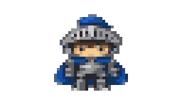
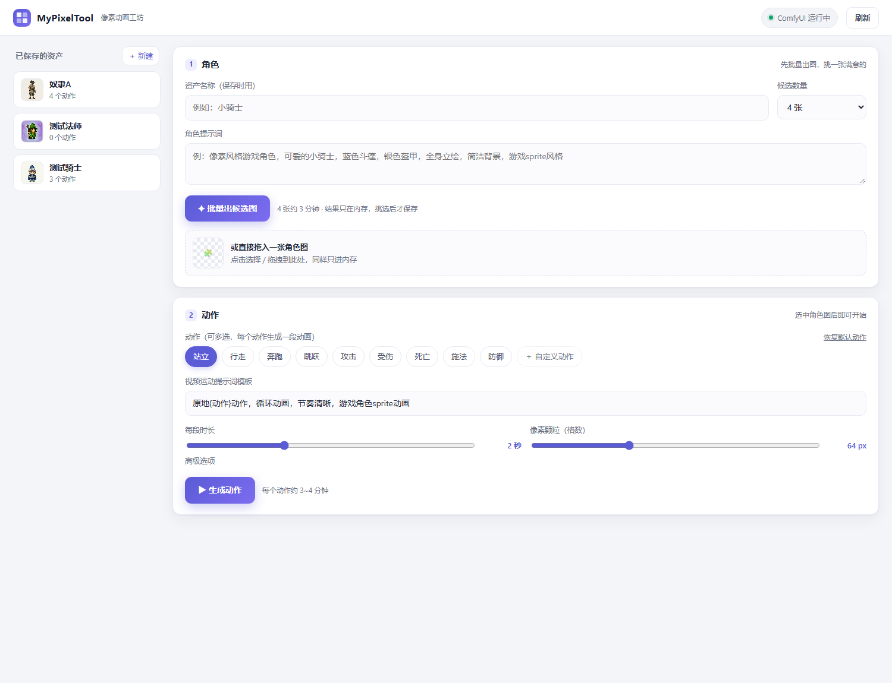
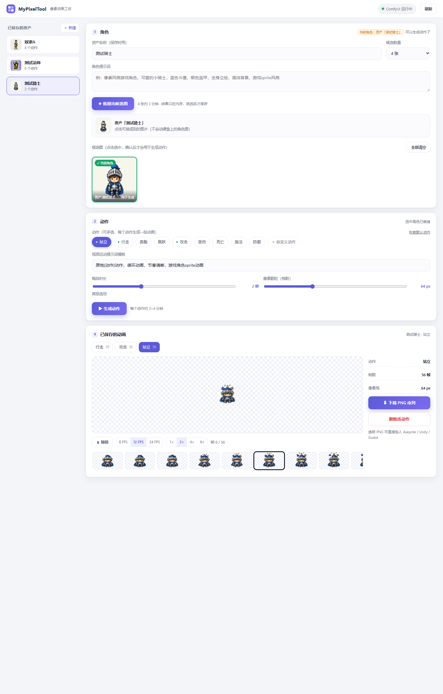

# Pixel Sprite Studio · 像素游戏角色动画生成器

给一句角色描述，本地产出**透明背景的像素动画帧序列**，可直接导入 Aseprite / Unity / Godot。
全程本地推理，不需要任何在线服务、不需要激活码。



```
文生图（Qwen-Image 2.1 Turbo）
      ↓  一次生成 2/4/6/8 张候选，你挑一张
图生视频（MiniMax H3 · 8 步加速）
      ↓
截帧 → 去背景（RMBG 2.0）→ 像素化（调色板量化 + 最近邻放大）
      ↓
你确认后才写硬盘
```



## 特性

- **先挑图再生动作**：批量出候选角色图，选中满意的再进动画环节，不浪费算力
- **零落盘试错**：所有中间结果（候选图、视频帧、遮罩）都存在 ComfyUI 进程内存里，只有点「接受」才写文件
- **8GB 显存可跑**：视频模型与抠图模型分时占用显存，去背景分块处理 + 显存不足自动减半重试
- **网页界面**：资产库 / 批量出图 / 动作多选（支持自定义动作）/ 待确认预览 / 透明背景播放器 / PNG 序列导出
- **资产管理**：点一下已保存的资产即可载入它的角色图继续生成新动作；资产和动作都可以随时删除
- **命令行可用**：`pipeline.py` 支持脚本化批量生成

## 环境要求

| 项目 | 要求 |
|---|---|
| 系统 | Windows 10/11（脚本为 .bat；其他平台用 Python 直接启动） |
| 显卡 | NVIDIA，**8GB 显存以上**（实测 RTX 5060 Laptop 8GB） |
| 驱动 | 支持 **CUDA 12.8+**（cu130 环境需 580 以上驱动） |
| Python | 3.10 ~ 3.12 |
| 磁盘 | 约 80 GB（模型 64 GB + 依赖约 8 GB） |
| 其他 | Git；能访问 GitHub / PyPI / hf-mirror（国内均可直连） |

## 快速开始

### 路线 A · 一键安装（推荐）

```bash
git clone https://github.com/MiracleCreater/pixel-sprite-studio.git
cd pixel-sprite-studio
```

Windows 直接双击 **`一键安装.bat`**，它会依次完成：

1. 克隆 ComfyUI v0.42.0 + 安装内存暂存节点
2. 安装 Python 依赖（CUDA 版 PyTorch 约 3GB + ComfyUI requirements）
3. **下载模型**（约 64 GB，断点续传，国内默认走 hf-mirror / ModelScope）
4. 把模型目录联接进 ComfyUI（不占双份空间）

完成后双击 **`Start-WebUI.bat`**（或 `MyPixelTool\启动网页界面.bat`），浏览器打开 <http://127.0.0.1:8899>。

> 命令行等价写法：`python install.py --install-torch --download-models --link-models`
> 已装过依赖的可以拆开跑：`python install.py --skip-deps` → `下载模型.bat` → `python install.py --link-models`

### 路线 B · 懒人整合包（不想装 Python）

从网盘（链接见下方「离线包」）下载两个文件，解压到同一目录：

| 文件 | 大小 | 内容 |
|---|---|---|
| `像素动画工坊-整合包.zip` | ~20 MB | 工具 + ComfyUI + 内存节点 |
| `comfyui内置环境包.7z` | ~5.2 GB | 免安装 Python 3.11 + PyTorch cu130 + 全部依赖 |

然后：`初始化模型目录.bat` → `下载模型.bat`（或手动放模型）→ `启动网页界面.bat`。

### 路线 C · 我已经有模型

把权重按下面的目录名放进 `models/`（或直接放进 `ComfyUI/models/`），然后：

```bash
python install.py --link-models     # 建联接，不复制文件
python download_models.py --check   # 校验文件名和大小
```

## 模型清单

共 7 个必需文件、约 64 GB。**文件名必须完全一致**（程序按名字加载）。
清单的机器可读版在 [`models/manifest.json`](models/manifest.json)（含精确字节数与 SHA256）。

| 放置目录 | 文件 | 大小 | 来源 |
|---|---|---|---|
| `diffusion_models/` | `qwen_image_2.1_turbo_bf16.safetensors` | 13.3 GB | [Comfy-Org/Qwen-Image-2.1](https://hf-mirror.com/Comfy-Org/Qwen-Image-2.1) |
| `diffusion_models/` | `fastvideo_fasth3_8step_v2_pruned_int8_convrot.safetensors` | 20.6 GB | [FastVideo/FastVideo-FastH3-Comfy](https://hf-mirror.com/FastVideo/FastVideo-FastH3-Comfy) |
| `text_encoders/` | `qwen3vl_8b_fp8_scaled.safetensors` | 9.9 GB | [Comfy-Org/Qwen3-VL](https://hf-mirror.com/Comfy-Org/Qwen3-VL) |
| `text_encoders/` | `qwen3vl_32b_minimax_h3_int4_convrot.safetensors` | 13.9 GB | [Merserk/MiniMax-H3-INT4-ConvRot](https://hf-mirror.com/Merserk/MiniMax-H3-INT4-ConvRot) ¹ |
| `vae/` | `qwen_image_2.1_vae_bf16.safetensors` | 0.6 GB | [Comfy-Org/Qwen-Image-2.1](https://hf-mirror.com/Comfy-Org/Qwen-Image-2.1) |
| `vae/` | `minimax_h3_video_vae_fp16.safetensors` | 4.9 GB | [Comfy-Org/MiniMax-H3](https://hf-mirror.com/Comfy-Org/MiniMax-H3) |
| `background_removal/` | `rmbg2.0.safetensors` | 0.8 GB | [briaai/RMBG-2.0](https://hf-mirror.com/briaai/RMBG-2.0) ²（下载后自动改名） |

可选：`vae/minimax_h3_audio_vae_fp32.safetensors`（0.6 GB）——本工具不生成音频，用不到。

> ¹ 官方仓库只有 bf16/int8/nvfp4 版；8GB 显存跑视频编码器需要这个 int4 量化版（清单里已记 SHA256）。
> ² briaai 官方仓库需要登录同意许可；脚本已配置 ModelScope 镜像直链，通常无需 token。
> 上面链接是 hf-mirror（国内直连），把域名换成 `huggingface.co` 即为官方地址。

## 使用流程

1. **① 角色**：填资产名 + 角色提示词 → 选候选数量 → 「批量出候选图」→ 点选满意的一张（也可直接拖图）
2. **② 动作**：勾选动作（站立/行走/攻击/受伤，或「＋ 自定义动作」）→ 调时长与像素颗粒 → 「生成动作」
3. **③ 待确认**：结果先进「待你确认」区（带动画预览），满意点「接受并保存」，否则「丢弃」释放内存
4. **④ 已保存**：播放 / 逐帧查看 / 导出 PNG 序列 ZIP；点左侧任意资产可载入其角色图**继续生成新动作**



## 命令行

```bash
# 生成角色 + 多个动作，直接保存
python MyPixelTool/pipeline.py --name 小骑士 --prompt "像素风格小骑士，蓝色斗篷" --actions 站立 攻击

# 用现成图片当角色图
python MyPixelTool/pipeline.py --name 小骑士 --image D:\角色.png --actions 行走

# 参数：--duration 秒数  --pixel 32~128  --steps 4~8  --video-size 640x352  --keep-video
```

## 离线包（网盘备用 · 不装 Python 也能跑）

> GitHub 路线需要本机有 Python 3.10+。如果连 Python 都不想装、或者 `pip install torch`
> 一直失败，走这条路线：**解压即用，整个工具自带解释器**。

**下载**：夸克网盘 <https://pan.quark.cn/s/1204f8f53360>（目录 `pixel-sprite-studio/`）

| 文件 | 大小 | 说明 |
|---|---|---|
| `像素动画工坊-整合包.zip` | ~20 MB | 工具本体 + ComfyUI 0.42.0 + 内存节点（不含模型） |
| `comfyui内置环境包.zip` | 3.1 GB（解压 5 GB） | 便携 Python 3.11 + PyTorch 2.10 cu130，已在目标机器验证可跑 |

**用法**（两个 zip 都下下来，解压到同一个目录）：

```
任意文件夹\
├── MyPixelTool\            ← 来自「整合包」
├── ComfyUI\                ← 来自「整合包」
└── comfyui内置环境包\       ← 来自「环境包」（python.exe 在这个目录里）
```

1. 双击 `MyPixelTool\初始化模型目录.bat` —— 把 `..\models\` 联接进 `ComfyUI\models\`
2. 把模型放进 `models\<子目录>\`（照 `models\manifest.json` 的 `target` 字段摆；见下方「模型」）
3. 双击 `MyPixelTool\启动网页界面.bat` —— 它会自动找到旁边的 `comfyui内置环境包\python.exe`
4. 浏览器打开 <http://127.0.0.1:8899>

> 环境包里的 torch 是 `2.10.0+cu130`，需要 **NVIDIA 驱动 >= 580**（含 CUDA 12.8 以上）。
> 驱动太老会报 `CUDA driver version is insufficient`，去 NVIDIA 官网更新即可，与网盘包无关。
>
> 网盘链接若失效请到 [Issues](https://github.com/MiracleCreater/pixel-sprite-studio/issues) 反馈。
> 模型本身**不必**从网盘下 —— `download_models.py` 能自动下全并校验。

## 目录结构

```
pixel-sprite-studio/
├── install.py                    安装脚本（clone ComfyUI / 装节点 / 装依赖 / 联接模型）
├── download_models.py            模型下载与校验（断点续传，依 models/manifest.json）
├── 一键安装.bat / Start-WebUI.bat
├── MyPixelTool/
│   ├── pipeline.py               流水线（工作流构建 / 内存中转 / 像素化）
│   ├── webui.py                  网页后端（标准库 HTTP，无额外框架）
│   ├── web/index.html            前端（单文件，零依赖）
│   └── setup_models.py           把 models/ 联接进 ComfyUI/models
├── custom_nodes/pixel_memory/    自定义节点：结果只存内存，不落盘
├── models/                       模型放这里（manifest.json 是权威清单）
└── ComfyUI/                      安装脚本自动克隆（不入库）
```

## 常见问题

**模型下载 403 / 需要授权？**
`rmbg2.0` 已配置 ModelScope 直链，一般不会遇到。若某个源要求登录：到 huggingface.co 同意该模型许可，然后 `set HF_TOKEN=你的token` 再重跑下载脚本。

**下载中断了怎么办？**
直接重跑 `下载模型.bat`，已完成的文件会跳过，未完成的从断点继续。

**去背景报 out of memory？**
已内置防护：去背景前自动卸载视频模型、按 8 帧分块、显存不足自动减半重试。若仍失败，关掉占用显存的程序再试。

**提示「缺少内存暂存节点」**
ComfyUI 是旧进程，关掉后重新生成即可（会自动重启并加载新节点）。

**端口 8899 / 8188 被占用**
8899 是网页界面，重复启动只会再开一个浏览器页；8188 是 ComfyUI，若被别的 ComfyUI 占用，请先关掉它。

**支持 Linux / macOS？**
核心逻辑跨平台：`python install.py --skip-deps` + `python download_models.py` + `python MyPixelTool/webui.py`，模型直接放进 `ComfyUI/models/`。`.bat` 仅是 Windows 便利封装。

## 许可证

- 本项目代码：**MIT**（见 `LICENSE`）
- `custom_nodes/pixel_memory`：作为 ComfyUI 插件运行，遵循 **GPL-3.0**
- ComfyUI 由安装脚本单独拉取，遵循其自身 **GPL-3.0**，不包含在本仓库中
- 模型权重版权归各自作者所有，本仓库不附带、不再分发；**RMBG 2.0 为非商用许可**，商用请向 BRIA 申请

## 致谢

[ComfyUI](https://github.com/comfyanonymous/ComfyUI) · [Qwen-Image](https://huggingface.co/Comfy-Org/Qwen-Image-2.1) · [FastVideo FastH3](https://huggingface.co/FastVideo/FastVideo-FastH3-Comfy) · [MiniMax H3](https://huggingface.co/Comfy-Org/MiniMax-H3) · [RMBG 2.0](https://github.com/Bria-AI/RMBG-2.0)
